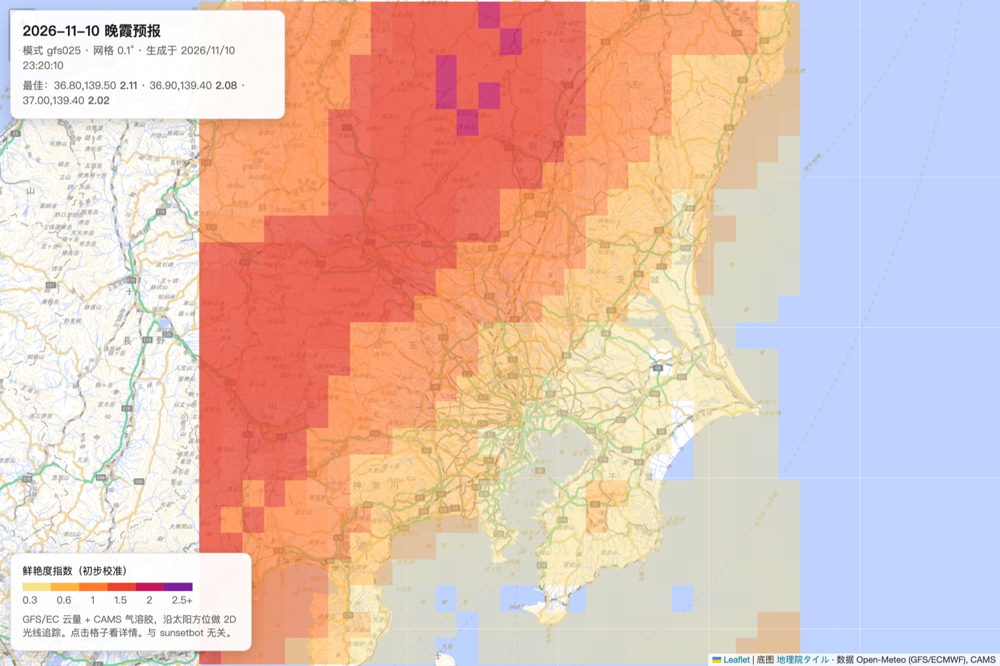

# sunsetglow

开源的朝霞/晚霞（火烧云）预报：输入任意地点的经纬度，告诉你今天的日落或明天的日出会不会烧、有多鲜艳、持续多久、几点最好看。

> **English summary.** sunsetglow forecasts sunrise/sunset glow ("burning clouds") for any location from free
> global weather-model data (GFS/ECMWF via Open-Meteo, CAMS aerosol). It ray-traces sunlight through a 2D
> cross-section of the atmosphere along the sun's azimuth, with Earth curvature and terrain, and scores how much
> of the sky lights up and for how long. Pure Python standard library, no API key. Output text is in Chinese.

- **全球可用**：任何经纬度都能算，日出、日落都支持。
- **物理模型**：沿太阳方位切一个大气截面，让阳光在弯曲的地球上穿过云、霾和山，算出每片云被照亮的程度和颜色。
- **零依赖**：只用 Python 标准库，不需要 API key，数据来自 [Open-Meteo](https://open-meteo.com/) 的免费接口。
- **区域地图**：一条命令生成单文件网页，看一片区域里哪里更值得去。
- **可校准**：自带回测脚本，可以用你自己记录的实况检验和调整指数。

思路来自 sunsetbot 公开的《火烧云预报教程》第一至四章。本项目与 sunsetbot 无隶属关系，也不使用它的数据或接口。

## 快速开始

需要 Python 3.9 或更高版本，并且能访问网络。

```bash
git clone https://github.com/b-z/sunsetglow.git
cd sunsetglow
python3 sunsetglow.py 35.68 139.76                       # 东京今天的晚霞
```

输出示例（东京，2026-11-10 日落）：

```
sunset 2026-11-10 07:37 UTC  sun azimuth 249.3°  model gfs025

鲜艳度指数(未校准)  0.48
持续时间            约 12 分钟 (-2 ~ +8 min)
峰值                +2 min, 覆盖 52% 天空弧, 颜色 深红
本地 AOD            0.11
观测点海拔          11 m
```

每一行的意思：

| 行 | 含义 |
|---|---|
| 第一行 | 日落时刻（UTC）、太阳方位角、所用的气象模式 |
| 鲜艳度指数 | 综合打分，越高越值得看，详见[下一节](#指数怎么理解) |
| 持续时间 | 天空明显发光的总时长；括号里是相对日落的起止分钟（负数表示日落前） |
| 峰值 | 最好看的时刻（相对日落）、那一刻发光部分占整条天空弧的比例，以及颜色 |
| 本地 AOD | 气溶胶光学厚度，越大越霾，0.1 左右算很干净 |
| 观测点海拔 | 从地形数据读出的海拔，用来计算视线 |

这一天的实况是大烧，所以 0.48 其实是低估了，见[准确度](#准确度)。

## 指数怎么理解

指数按时间累积：**整条天空弧（从太阳一侧的地平线经过头顶到背后的地平线）全部明亮发光 6 分钟，约等于 1.0。**
所以它同时反映了烧的面积、亮度和持续时间。

地图和程序里用的分档如下：

| 指数 | 等级 | 大致样子 |
|---|---|---|
| < 0.3 | 无 | 普通暮色，或者只有地平线附近一点颜色 |
| 0.3 – 1.0 | 微烧 | 局部的云被染色，时间短 |
| 1.0 – 1.5 | 小烧 | 有一片明显被染红的云 |
| 1.5 – 2.0 | 中烧 | 大片天空发红 |
| ≥ 2.0 | 大烧 | 大半个天空烧起来 |

**这些档位是初步的。** 它们来自上海的 20 次实况；加州的数据显示「小烧」的切分约在 0.4，
日本的两次大烧实况指数只有 0–0.8（见 [docs/VALIDATION.md](docs/VALIDATION.md)）。
建议先把指数当作相对值来用：同一地点，数值越高越值得出门。如果想定一个自己的提醒门槛，
0.5 左右是比较稳妥的起点；也可以用自己的观测记录来校准（见[校准回测](#校准回测)）。

## 用法

### 单点预报

```bash
python3 sunsetglow.py 31.23 121.47                                   # 上海今天日落
python3 sunsetglow.py 35.68 139.76 --event sunrise --date 2026-12-01 # 指定日期的日出
python3 sunsetglow.py 31.23 121.47 --model ecmwf_ifs025              # 换用 ECMWF
python3 sunsetglow.py 35.36 138.73 --png sky.png                     # 另存全景图
```

| 参数 | 默认 | 说明 |
|---|---|---|
| `lat lon` | 必填 | 观测点纬度、经度（十进制度，南纬和西经用负数） |
| `--event` | `sunset` | `sunset` 日落 / `sunrise` 日出 |
| `--date` | 今天 | 本地日期 `YYYY-MM-DD`，可以是过去的日期（回看）或未来几天 |
| `--model` | `gfs025` | Open-Meteo 的模式名，例如 `ecmwf_ifs025`、`icon_global` |
| `--haze-height` | `1.0` | 气溶胶标高（km），默认值来自回测 |
| `--flat` | 关 | 忽略地形，按海平面上的平地计算 |
| `--diag` | 关 | 用模式的整层中/高云量补回分层数据里漏掉的薄云层（实验性） |
| `--png` | — | 另存全景图：纵轴从太阳侧地平线经天顶到背日侧，横轴是时间 |

计算日落时，程序会覆盖日落前 10 分钟到日落后 45 分钟；计算日出时方向相反。

两个模式的结果经常不一样。重要的场次，建议用 `gfs025` 和 `ecmwf_ifs025` 各算一次。

### 区域地图

```bash
python3 glowmap.py --bbox 34.8,37.2,138.3,141.0 --step 0.1 --out kanto.html   # 南,北,西,东
```

生成一个单文件网页（Leaflet），用浏览器打开即可：



*2026-11-10 关东晚霞（事后回算，gfs025）。这一天东京实况大烧；地图上西北部山区的指数超过 2，东京市区约 0.5。*

- 每个格子的颜色代表在那里看到的指数；没有颜色的格子低于 0.3。
- 点一个格子，可以看那里的日落时刻、持续时间、峰值、颜色、AOD，以及复现这个点的单点命令。
- 日本范围内用国土地理院的淡色底图（地名为日文），其他地区用 Esri 底图。
- 时间按浏览器所在的时区显示。

| 参数 | 默认 | 说明 |
|---|---|---|
| `--bbox` | 必填 | 范围：南纬,北纬,西经,东经 |
| `--step` | `0.25` | 地图格子大小（度） |
| `--event` / `--date` / `--model` / `--flat` | 同单点 | |
| `--field-step` | `0.5` | 拉取模式数据的网格（度） |
| `--workers` | CPU 核数 | 并行进程数 |
| `--out` | `map.html` | 输出文件 |

地图先拉一张覆盖整个范围的模式数据场：朝太阳方向外扩 700 km、背向外扩 300 km。
每个格子的截面都从这张场插值，因此比逐点调用省很多额度。关东范围按 0.1° 计算，
首次大约需要 3 分钟，并消耗约 1500 次 Open-Meteo 调用额度（见[额度与缓存](#额度与缓存)）。

### 校准回测

如果你记录了自己看到的天空，可以用回测检验指数准不准，并找出适合你所在地区的档位。

```bash
python3 backtest.py my_labels.csv
```

`my_labels.csv` 每行记录一次实况：

```csv
date,lat,lon,event,observed,source,note
2026-11-10,35.68,139.76,sunset,4,my photo,整片高积云烧红
```

- `date`：本地日期。
- `event`：`sunset` 或 `sunrise`。
- `observed`：实况等级，0 无、1 微烧、2 小烧、3 中烧、4 大烧，可以用半级（例如 2.5）。

脚本会：

1. 从 Open-Meteo 的历史预报存档取出当时真实发布的预报，不是事后的再分析；
2. 按默认的参数组合（气溶胶标高 1 / 1.5 / 2.5 km × 云块尺度 0 / 10 / 30 / 100 km）重算指数；
3. 输出 Spearman 相关、「≥小烧」的 AUC、最佳参数组合和各等级的指数切分；
4. 把逐条结果写到 `backtest_results.csv`。

注意两点：

- 样本里**必须同时有烧和没烧的事件**，否则算不出 AUC。
- 少于 30 条时，结果只能当作参考。

仓库里自带两组标签：[labels/phenocam_california.csv](labels/phenocam_california.csv) 和
[labels/field_japan.csv](labels/field_japan.csv)。

### 自检

```bash
python3 test_synthetic.py
```

这个脚本不联网，用人造的云场检查模型行为是否合理：高云比低云好看、霾会削弱颜色、山会挡光等等。

## 原理

| 步骤 | 做法 |
|---|---|
| 1. 太阳 | 用 NOAA 算法求日出/日落时刻和太阳方位角。 |
| 2. 截面 | 沿太阳方位角从 −300 到 +700 km，每 50 km 取一列模式数据，包括各气压层的云量、高度、温度，以及 CAMS 气溶胶。这些数据组成一张二维大气截面。 |
| 3. 受光 | 对截面里每个有云的格点，在弯曲的地球上朝太阳追踪光线，碰到地形就算被挡住。沿途累积瑞利散射、气溶胶和云的消光，分 650 / 550 / 450 nm 三个波长计算颜色。 |
| 4. 观测 | 从观测点的海拔出发，沿天空弧（太阳侧地平线 → 天顶 → 背日侧）逐个方向发出视线，累积看到的光；前方的云、霾和山都会遮挡。 |
| 5. 评分 | 亮度高于入射光的 1/30 算明亮，低于 1/5000 算不可见；再结合颜色的饱和度。按时间累积发光的覆盖率，得到指数、持续时间、峰值和颜色。 |

几个关键处理：

- **部分云量（云块模型）**：45% 的云量如果均匀铺开，低角度的阳光很快就会被完全挡住；而实际的碎云之间有缝，光能透过去。
  所以部分云层被看作「每 30 km 一个云块」，光线按云量的概率遇到云块（`CLOUD_ELEMENT_KM`）。
- **云的光学厚度**：按温度粗估，水云约 10，冰云约 1。
- **地形**：高程来自 AWS 的 Terrarium 瓦片（约 500 m 一像素），沿太阳方位每 2 km 取一个点。
  平原城市基本不受影响；山区、山脚，或在山上俯看云海时影响较大。

合成场景的结果顺序和教程的结论一致：高云加上不远处的云边界、空气又干净时最好；霾会削弱颜色；中云的发光时间更短；低云很弱；
满天云、没有边界时只能透过一点光。详见 `test_synthetic.py`。

## 准确度

| 数据集 | 事件数 | Spearman | AUC（≥小烧） |
|---|---|---|---|
| 上海，sunsetbot 公开实况 | 20 | +0.63 | 0.88 |
| 加州，PhenoCam 摄像头 | 87 | +0.44 | 0.86 |
| 日本，实地观测 | 2 | — | 两次中烧以上都明显低估 |

AUC 0.5 等于瞎猜，1.0 表示完美区分。作为对照，sunsetbot 在上海同一批数据上的成绩是 +0.84 / 0.98，
不过它是事后用再分析数据算的，比真实预报占便宜。

各数据集的细节、参数是怎么定下来的、已知漏报的分析，以及和 Sunsethue、Alpenglow 的对比，
见 [docs/VALIDATION.md](docs/VALIDATION.md)。

## 已知局限

- **只算一个方向。** 只计算太阳方位角上的一条二维截面。偏在南北两侧的云即使烧红了，也算不进来。
- **薄云层可能漏掉。** 模式的分层云量会漏掉夹在两个气压层之间的薄层高积云或卷云，这是目前低估的主要原因之一。
  `--diag` 可以部分补救，但在回测里没有整体提升，所以默认关闭。
- **受模式时效限制。** 模式对云带移动的时间可能差一两个小时，而晚霞对云的位置非常敏感。
- **云的光学性质很粗。** 云的光学厚度只按温度估算，没有用模式里的含水量；部分云量的透光也只用一个全局的云块尺度来近似。
- **地形有误差。** 地形瓦片约 500 m 一像素，尖峰会被削低（富士山读出 3705 m，实际 3776 m）。
  另外，大气折射也没有考虑。
- **全景图有横向条纹。** 这是气压层离散造成的，并不是真实的云结构。
- **地图和单点略有差异。** 地图用了插值和较粗的时间、角度步长，结果和单点会有小差异，
  例如 36°N 139°E：地图 0.40，单点 0.29。

## 额度与缓存

Open-Meteo 的免费接口按加权调用次数限流：每分钟 600 次、每小时 5000 次、每天 10000 次。

| 操作 | 约消耗 |
|---|---|
| 单点一次 | 70 次 |
| 关东地图（0.1°） | 1500 次 |

- 缓存位置：模式数据缓存在 `.cache/`；地形瓦片缓存在 `.cache/terrain/`，不占 Open-Meteo 的额度。
- 缓存时长：实时预报缓存 3 小时后过期；历史存档和地形永久保留。
- 遇到每分钟或每小时的限流时：地图和回测会自动等待后重试；单点预报会直接报错，等一分钟再运行即可。
- 每天的额度用完时，程序直接报错退出；额度在 UTC 0 点（日本时间早上 9 点）重置。

## 数据来源

- 天气：[Open-Meteo](https://open-meteo.com/)（NOAA GFS、ECMWF IFS 等），CC BY 4.0
- 气溶胶：CAMS Global，经 Open-Meteo Air Quality API
- 地形：[Terrarium 高程瓦片](https://registry.opendata.aws/terrain-tiles/)（AWS Open Data；Mapzen/Tilezen 整合 SRTM 等）
- 底图：[地理院タイル](https://maps.gsi.go.jp/development/ichiran.html)（日本）、Esri Canvas（其他地区）
- 加州回测图像：[PhenoCam Network](https://phenocam.nau.edu)

## 参与

欢迎提交实况记录：拍到（或确认没有）朝霞晚霞时，按[校准回测](#校准回测)的格式记一行，附上地点和简短描述，
通过 issue 或 pull request 提交。来自不同地区的实况，是把档位从「上海经验」变成真正可用的唯一途径。

## 许可证

GPL-3.0-or-later，见 [LICENSE](LICENSE)。
